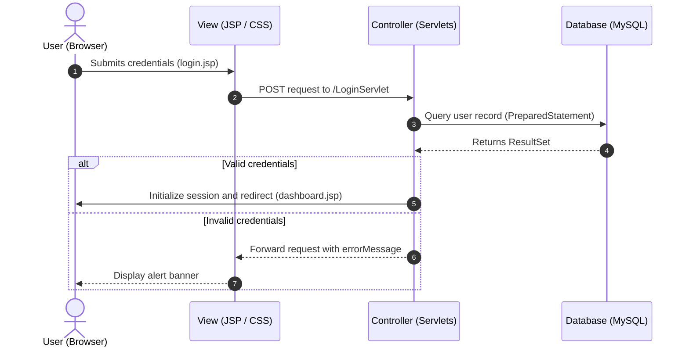

<div align="center">

# 🎓 Student Portal

[](https://www.oracle.com/java/)
[](https://jakarta.ee/)
[](https://tomcat.apache.org/)
[](https://www.mysql.com/)

*A full-stack, session-managed web application for student registration, authentication, and profile tracking.*

[Features](#-features) • [Tech Stack](#-tech-stack) • [Database Setup](#-database-setup) • [Installation](#-installation--setup) • [Architecture](#-application-architecture)

</div>

## 📌 Overview

The **Student Portal** is an enterprise-style Java web application built with **Jakarta EE (Servlets and JSP)**, **JDBC**, and **MySQL**. It provides student registration, authentication, and profile display through a session-managed web interface with responsive CSS styling and dynamic status alerts.

The application uses `PreparedStatement` for database queries and `try-with-resources` for JDBC resource cleanup.

## ✨ Features

- 🔐 **Authentication and session security:** Login state is managed with `HttpSession`, and logout invalidates the active session.
- 📝 **Smart student registration:** Validates password confirmation, parses GPA values, and handles duplicate username collisions.
- 🛡️ **Session guard:** Prevents unauthenticated access to protected pages such as `dashboard.jsp`.
- 🗄️ **JDBC database access:** Connects to MySQL through a reusable database connector and cleans up JDBC resources automatically.
- 🎨 **Responsive user interface:** Uses custom CSS cards, styled error and success alerts, and clean typography.

## 🛠️ Tech Stack

| Component | Technology | Version |
| :--- | :--- | :--- |
| **Language** | Java SE | 17+ |
| **Web framework** | Jakarta Servlets and JSP | EE 11 / Servlet 6.0 |
| **Database** | MySQL Server | 8.0+ |
| **JDBC driver** | MySQL Connector/J | 8.3.0 |
| **Application server** | Apache Tomcat | 11.0.27 |
| **Frontend** | HTML5, CSS3, JSP Expression Language | Native |

## 🗃️ Database Setup

Run the following SQL commands in MySQL Workbench or the MySQL command-line client:

```sql
CREATE DATABASE IF NOT EXISTS studentdb;
USE studentdb;

CREATE TABLE IF NOT EXISTS student (
    id INT AUTO_INCREMENT PRIMARY KEY,
    username VARCHAR(50) NOT NULL UNIQUE,
    password VARCHAR(255) NOT NULL,
    fullname VARCHAR(100) NOT NULL,
    gpa DOUBLE NOT NULL,
    major VARCHAR(100) DEFAULT 'CSE'
);
```

> [!IMPORTANT]
>
> Ensure the credentials in `DBConnector.java` match your local MySQL configuration:
>
> ```java
> private static final String URL = "jdbc:mysql://localhost:3306/studentdb";
> private static final String USER = "root";
> private static final String PASSWORD = "your_mysql_password";
> ```

## 📁 Project Structure

```text
student_portal/
├── src/
│   └── main/
│       ├── java/com/example/studentportal/
│       │   ├── DBConnector.java          # Utility class for JDBC connections
│       │   ├── LoginServlet.java         # Authentication and session handling
│       │   ├── LogoutServlet.java        # Session termination
│       │   └── RegistrationServlet.java  # Input validation and database insertion
│       └── webapp/
│           ├── css/
│           │   └── style.css             # Main stylesheet
│           ├── dashboard.jsp             # Protected student profile view
│           ├── index.jsp                 # Landing page and redirect
│           ├── login.jsp                 # Login form with status alerts
│           ├── register.jsp              # Registration form
│           └── WEB-INF/
│               ├── classes/              # Compiled servlet bytecode
│               └── lib/
│                   └── mysql-connector-j-8.3.0.jar
└── README.md
```

## 🚀 Installation & Setup

### 1. Clone the repository

```bash
git clone https://github.com/your-username/student_portal.git
cd student_portal
```

### 2. Configure the database

1. Start MySQL and create the `studentdb` database using the SQL script above.
2. Update the connection credentials in `DBConnector.java`.
3. Confirm that `mysql-connector-j-8.3.0.jar` is available in `src/main/webapp/WEB-INF/lib/`.

### 3. Configure Eclipse

1. Open Eclipse and select **File** → **Import** → **Existing Projects into Workspace**.
2. Select the cloned project.
3. Right-click the project and open **Properties** → **Java Build Path** → **Source**.
4. Set the default output folder to:

   ```text
   student_portal/src/main/webapp/WEB-INF/classes
   ```

### 4. Configure Deployment Assembly

In **Properties** → **Deployment Assembly**, verify the following mappings:

| Source | Deploy path |
| :--- | :--- |
| `/src/main/webapp` | `/` |
| `/src/main/java` | `/WEB-INF/classes` |

### 5. Run on Tomcat

1. Start the MySQL service:

   ```bash
   sudo systemctl start mysql
   ```

2. In Eclipse, right-click `index.jsp` and select **Run As** → **Run on Server**.
3. Choose Apache Tomcat 11.0.
4. Open the application at <http://localhost:8080/student_portal/>.

## 🔄 Application Architecture



## 🛣️ API & Route Mapping

| Route | HTTP method | Access level | Description |
| :--- | :--- | :--- | :--- |
| `/` | `GET` | Public | Redirects to `login.jsp`. |
| `/login.jsp` | `GET` | Public | Displays the login form and status alerts. |
| `/LoginServlet` | `POST` | Public | Processes user authentication. |
| `/register.jsp` | `GET` | Public | Displays the registration form. |
| `/RegistrationServlet` | `POST` | Public | Validates and inserts a new student. |
| `/dashboard.jsp` | `GET` | **Protected** | Displays the authenticated student's profile. |
| `/LogoutServlet` | `GET` | **Protected** | Invalidates the session and redirects to login. |
